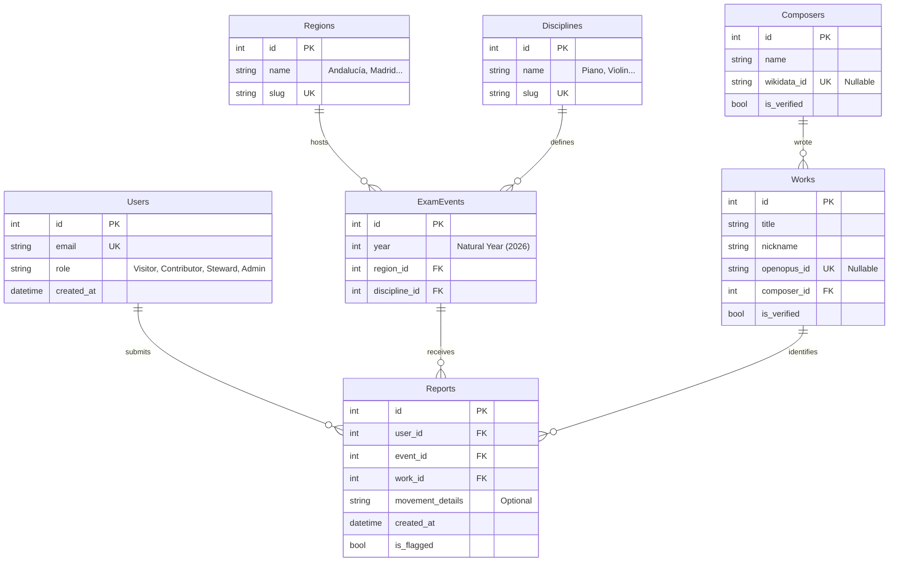

# Technical Specifications: Exam Record

## 1. Technology Stack

### Backend (Core)
*   **Language:** Python 3.12+
*   **Framework:** **FastAPI** (Async).
*   **Database ORM:** **SQLAlchemy (Async)** version 2.0+.
*   **Migrations:** Alembic.
*   **Authentication:** JWT (Stateless) via Magic Link email flow.

### Frontend (Hybrid Approach)
Given the requirement for SEO (browse pages) and complex interactions (data entry), we will use a hybrid stack:
*   **Server-Side Rendering (SSR):** **Jinja2** templates served by FastAPI. Excellent for SEO and initial load speed.
*   **Interactivity:** **HTMX** for partial page reloads (Voting, Search filtering).
*   **Complex State (Data Input):** **Alpine.js** or **Preact** (embedded) for the "Contribution Engine" (Phase 1-3 wizard) which requires instant client-side validation and state management without roundtrips.

### Persistence
*   **Database:** **SQLite** (Development/Beta). Easy to backup and sufficient for the "Constrained Scope" (Andalucía/Piano). Can migrate to PostgreSQL later.
*   **Cache:** In-memory (Dict) or Redis for the "Top 500 Composers" list.

---

## 2. Database Schema (ERD)

The schema separates the "Event" (container), the "Report" (one work proposed for an event) and the "Vote" (one user backing one report).

> The diagram below is the original design. The live schema (`app/models.py`) adds:
> a `votes` table (`user_id`, `report_id`, `event_id`, `created_at`) with a unique
> `(user_id, event_id)` index, a unique `(event_id, work_id)` constraint on `reports`,
> `composers.openopus_id`, and `works.imslp_url`.

### Key Logic
*   **Consensus Calculation:** We do not store "Consensus" in a table. `ConsensusService` calculates it on the fly by counting the `Votes` on each `Report` of an event (each work has at most one report per event).
*   **Event creation:** An `ExamEvent` row is created when the first report for that region/discipline/year is submitted, never on a page view.

---

## 3. API Design (Key Endpoints)

### auth
*   `POST /api/auth/magic-link`: Emails a link holding a 15-minute link token. Stores nothing.
*   `GET /api/auth/verify?token=...&next=...`: Creates the user if new, sets a 30-day HTTP-only session cookie, redirects to `next` (same-site paths only).
*   Rate limits (`app/core/constants.py`): link requests per IP and per target email; votes and reports per signed-in user.

### search
*   `GET /examenes/{region}/{discipline}/{year}`: Returns the Exam Event page with list of proposed works + consensus status. (`/exams/...` redirects here.)
*   `GET /examenes/{region}`: Coverage table, disciplines × the last 12 years.
*   `GET /estadisticas[?especialidad=slug]`: Most frequent composers, and works that fell at least twice.
*   `GET /obras/{id}-{slug}`: A work and every exam it appeared in.
*   `GET /compositores/{id}-{slug}`: A composer's works that appeared, with years. In both, the id decides and a wrong slug redirects.
    *   *Response:* HTML (SSR).

### submission (The Contribution Engine)
*   `GET /api/composers/search?q=...&source=local|external`: Local composers, or OpenOpus + Wikidata merged.
*   `GET /api/works/search?q=...&composer_id=...`: One composer's works, local and OpenOpus merged (`openopus_composer_id` for composers not stored yet).
*   `POST /api/reports`: Submits a new exam report.
    *   *Payload:* `{ region_slug, discipline_slug, year, composer: {...}, work: {...}, scope, movement_details }`
    *   *Logic:* Handles "Get or Create" for the Event, Composer and Work, and casts the submitter's vote.

### moderation
*   `POST /api/reports/{id}/flag`: Flags an entry.
*   `POST /api/reports/{id}/vote`: Quick "Me too" vote (adds a Vote to the existing Report; one per user and event).

### admin (server-rendered, role `Admin` only, 404 for anyone else)
*   `GET /admin`: Flagged reports, works, composers, all reports, count of empty exams.
*   `POST /admin/reports/{id}/clear-flag`, `POST /admin/reports/{id}/delete`
*   `POST /admin/works/merge`, `GET|POST /admin/works/{id}` (edit), `POST /admin/works/{id}/link` (OpenOpus), `POST /admin/works/{id}/delete`
*   `POST /admin/composers/merge`, `POST /admin/composers/rename`
*   `POST /admin/events/delete-empty`
*   `GET /admin/backup`: downloads a gzipped snapshot of the database (see `backups.md`).
*   Roles are granted with `scripts/set_role.py`.

---

## 4. External Integrations
*   **Wikidata** (`services/wikidata.py`): composer lookup through the `wbsearchentities` API (not SPARQL).
*   **OpenOpus API** (`services/openopus.py`): works by composer, fetched live and filtered locally.
*   OpenOpus catalogues are cached in memory per composer for a day, with titles rendered in Spanish by `services/titles.py`. `services/catalog_service.py` merges local and external results.
